# PhotoExhibition

PhotoExhibition 是面向摄影师、活动摄影团队和照片收藏者的自部署影像展示与管理平台。它包含公开浏览站点、用户工作台和超级管理员后台，可按相册、照片墙、随机浏览和人物等方式呈现作品。

[功能模块](#功能模块) · [技术架构](#技术架构) · [快速开始](#快速开始) · [应用商店介绍](docs/STORE_LISTING.md)

## 功能模块

| 模块 | 当前实现 |
| --- | --- |
| 公开站点 | 相册分类、照片墙、随机浏览、人物页、关键词搜索、条件筛选、照片查看器、EXIF 信息、评论和分享页面；移动端适配。 |
| 内容管理 | 文件与文件夹上传、目录浏览、相册绑定与聚合、封面和排序设置、图片移动/删除、标签及人物管理；支持相册展示与下载权限控制。 |
| 多用户 | 注册与登录、独立公开站点路径、用户资料、容量配额、管理员及超级管理员角色；可配置短信和邮件验证。 |
| 存储 | 本地存储，以及多种可配置的远程存储提供者；各提供者支持的上传、浏览、预览和扫描能力由后台能力提示确定。 |
| 后台任务 | 照片扫描、缩略图、EXIF、颜色、人脸与视觉分析等任务的进度和历史记录。 |
| AI 扩展 | 本地 ONNX 模型用于人脸、场景、情绪、显著性、抠图等分析；可配置的 AI 服务用于搜索和图片视觉分析。模型文件及服务配置需自行提供。 |
| 商业化配置 | 会员套餐、容量、订单和支付配置及管理界面；实际支付能力取决于所选渠道的配置与联调状态。 |

平台以照片公开展示和管理为核心。可选功能的开关、模型、外部服务和存储支持情况会影响实际可用范围，部署前请在后台核对。

---

## 图片预览
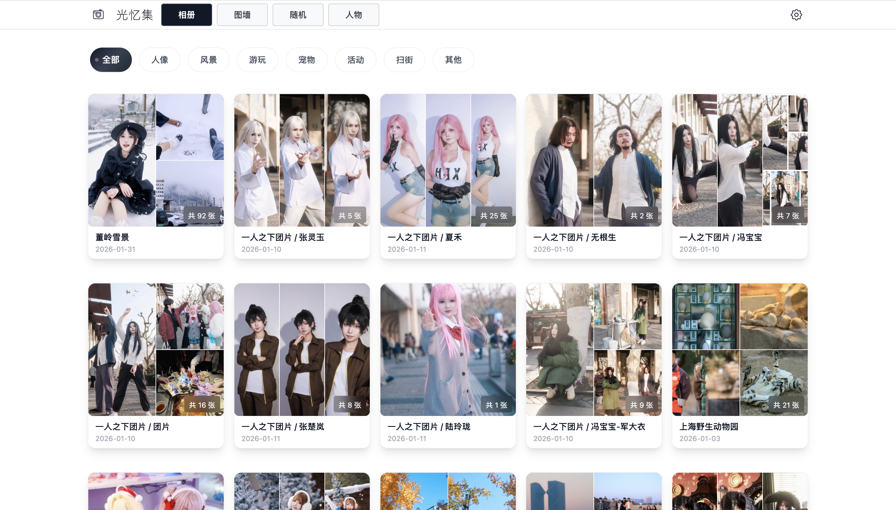

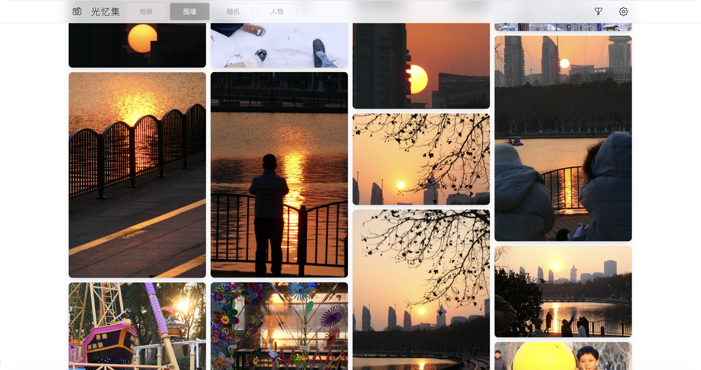

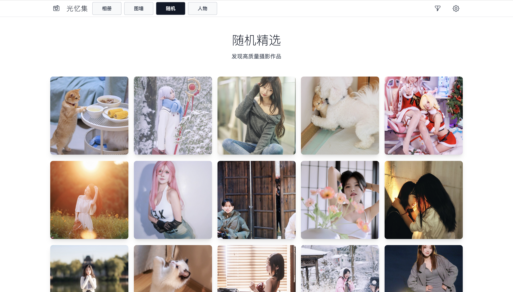


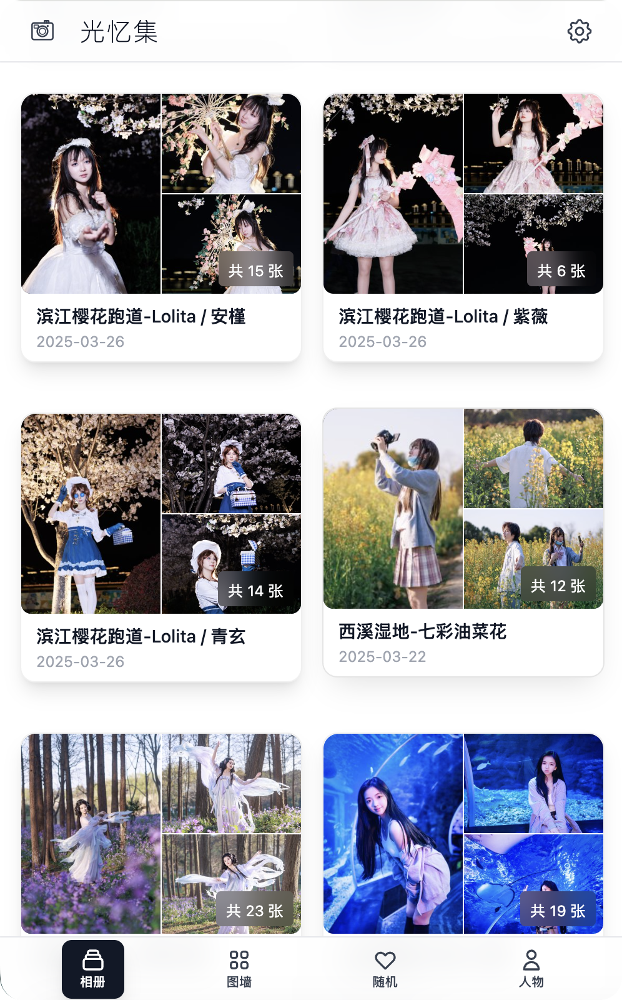

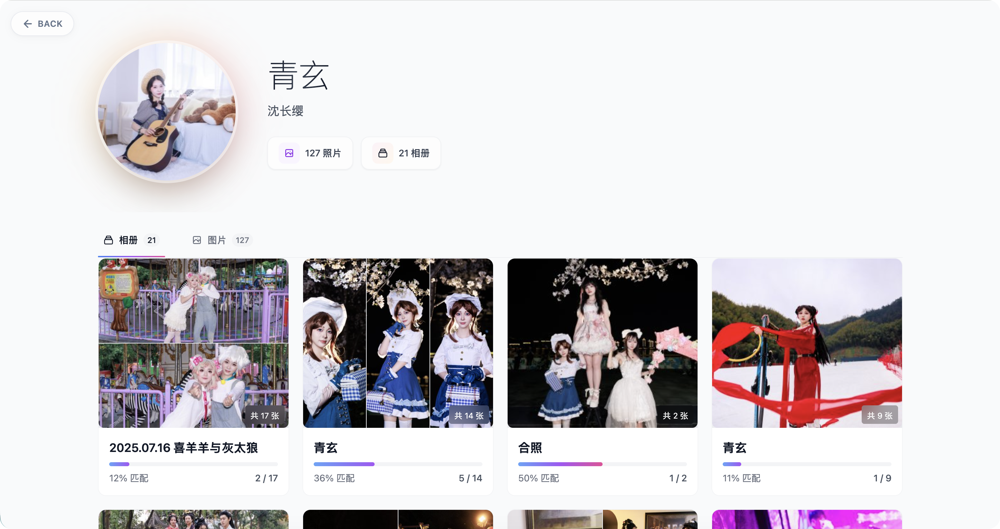

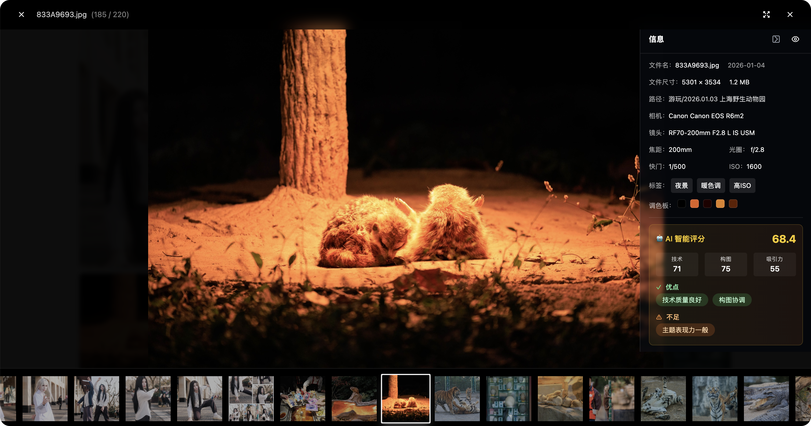

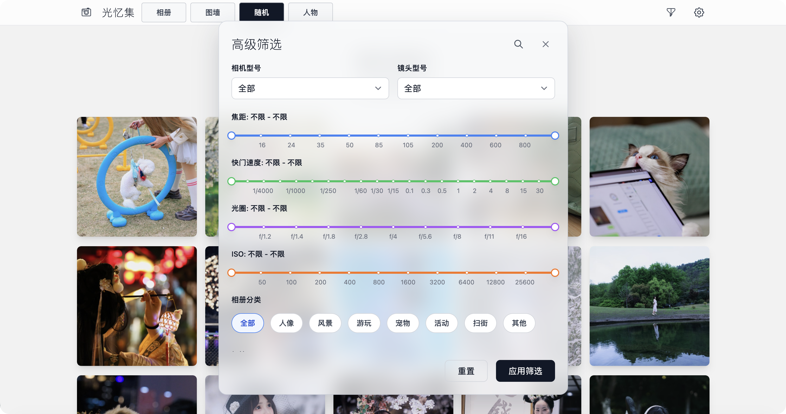

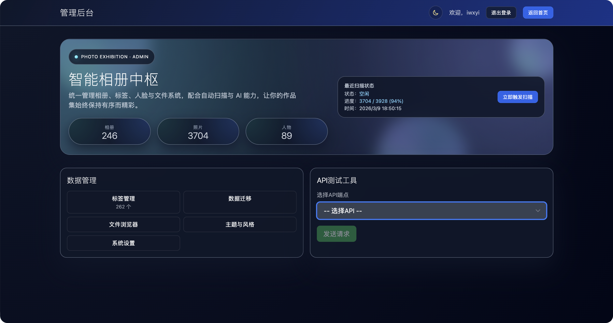

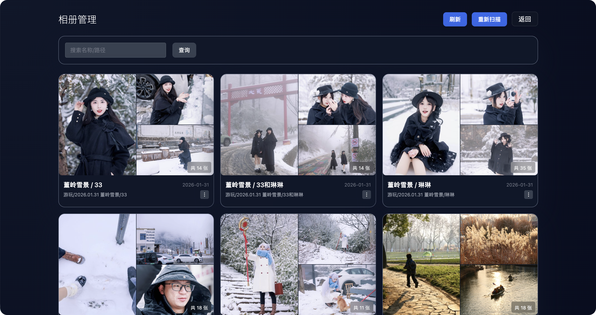

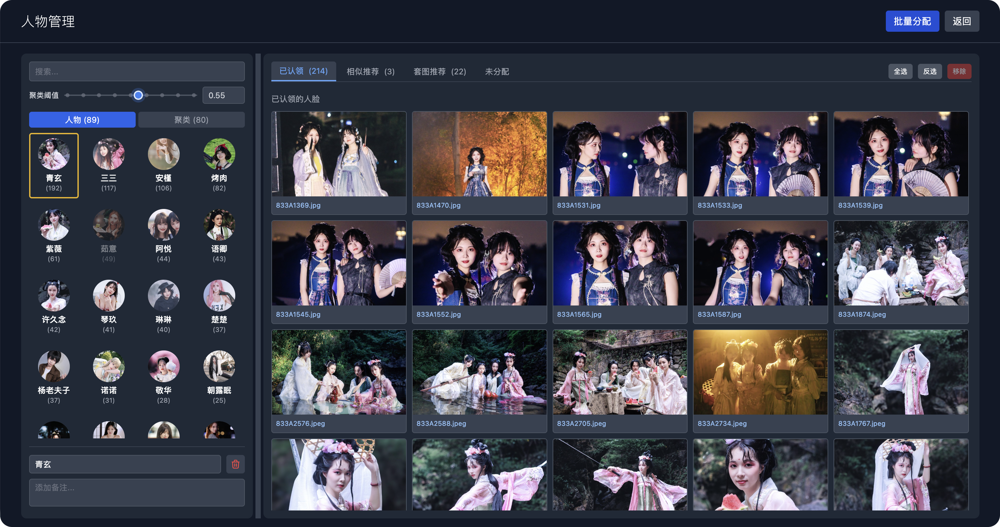

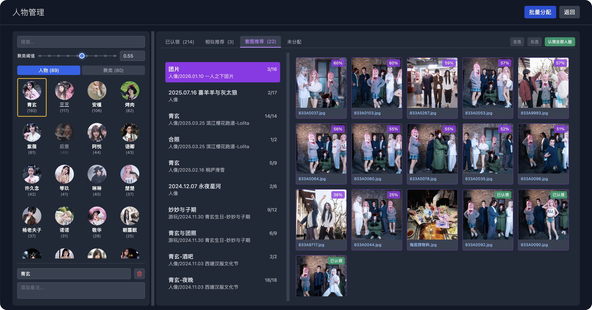

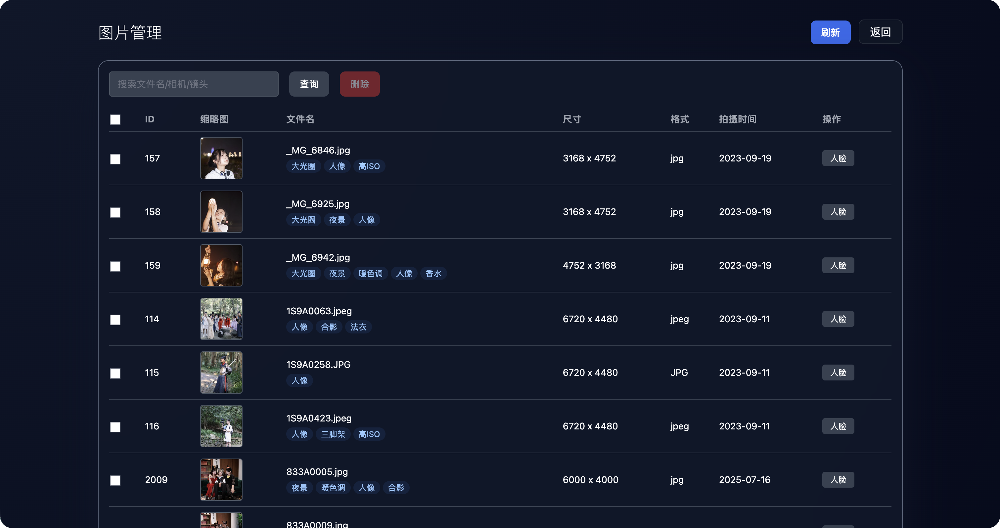

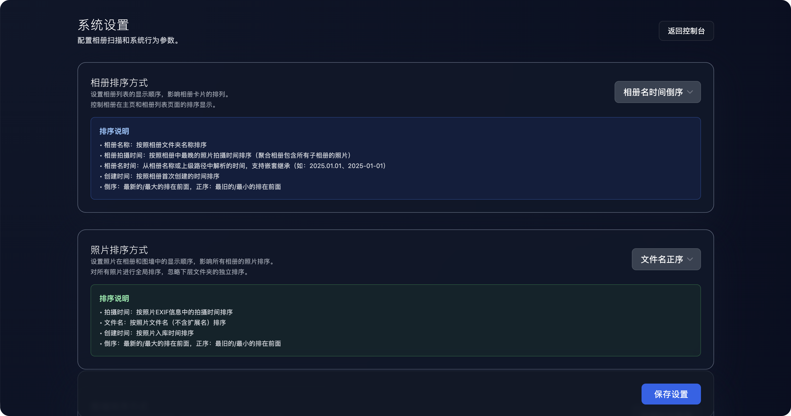

---

## 技术架构

- **前端**：Vue 3、TypeScript、Vite、Pinia、Vue Router、Tailwind CSS；通过 `/api` 访问后端。
- **后端**：Java 11、Spring Boot 2.7、Spring Data JPA；REST API 使用 `/api` 上下文路径，默认端口 `6060`。
- **数据库与缓存**：默认配置使用 MySQL；Docker Compose 同时启动 MySQL 与 Redis。无 Redis 的本地开发需显式传入 `--spring.redis.host=disabled`，使用内存缓存回退。
- **图片与 AI**：后台扫描目录并生成缩略图及元数据；ONNX Runtime 承载可选本地模型，AI 搜索与视觉分析可连接外部服务。仓库不包含所需的 `.onnx` 模型文件。
- **管理边界**：普通后台负责站点内容；超级管理员后台负责用户、存储、模型、任务、会员与第三方服务配置。跨用户公开路径使用 `/{slug}` 前缀。

关键代码位于 `frontend/src/views`、`frontend/src/components`、`backend/src/main/java/com/photoexhibition/controller` 与 `backend/src/main/java/com/photoexhibition/service`。新增存储或支付渠道时，先核对对应服务的实际能力与回调实现，不应仅以后台出现的配置项判断已可生产使用。

## 快速开始

### Docker 部署
```bash
# 1. 获取项目
git clone https://github.com/iwxyi/PhotoExhibition.git
cd PhotoExhibition

# 2. 组织您的照片文件
mkdir -p data/photos
# 建议的文件结构：
# data/photos/
# ├── 人像/
# │   ├── 2024.01.15 张三生日聚会/
# │   │   ├── IMG_0001.jpg
# │   │   └── IMG_0002.jpg
# │   └── 2024.02.20 李四毕业照/
# │       ├── IMG_0003.jpg
# │       └── IMG_0004.jpg
# ├── 风景/
# │   ├── 2024.03.10 樱花季/
# │   └── 2024.04.05 海边日出/
# └── 活动/
#     ├── 2024.05.01 五一劳动节/
#     └── 2024.06.15 端午节龙舟赛/

# 3. 一键启动
docker-compose up -d

# 4. 开始浏览
# 打开浏览器访问: http://localhost:3030
# 首次初始化的默认超级管理员账户: admin / admin
```

首次登录后请立即修改默认密码。`docker-compose.yml` 使用独立的 MySQL、Redis 容器和固定端口，适合单实例试用；生产部署应自行设置数据库密码、密钥、持久化目录和反向代理。

### 本地开发

准备 Java 11、Maven、Node.js、npm 与 MySQL，并创建 `photo_exhibition` 数据库。数据库连接默认值在 `backend/src/main/resources/application.yml` 中，可通过 `PHOTO_DB_HOST`、`PHOTO_DB_PORT`、`PHOTO_DB_NAME`、`PHOTO_DB_USER`、`PHOTO_DB_PASSWORD` 覆盖。

在两个终端分别运行：

```bash
cd backend
mvn spring-boot:run -Dspring-boot.run.jvmArguments="-Djava.awt.headless=true" -Dspring-boot.run.arguments="--spring.redis.host=disabled"
```

```bash
cd frontend
npm install
npm run dev
```

前端默认访问 `http://localhost:3030`，Vite 将 `/api` 代理到默认的 `http://127.0.0.1:6060`。构建验证分别使用 `cd backend && mvn test` 和 `cd frontend && npx vite build`。

### 同一 MySQL 上部署两个实例

Windows 可直接运行根目录的 `start.bat`，依次拉取代码、构建前后端并启动后端，需要已安装 Git、Node.js/npm、Java 11+、Maven，并已启动 MySQL。未配置时使用默认端口 `6060` 和数据库 `photo_exhibition`。需要自定义时，取消脚本顶部对应 `set` 行的 `REM` 注释并修改值；配置仅作用于当前脚本及其启动的程序，不影响其他实例。前端构建产物仍需由 Nginx 等 Web 服务部署，该脚本不会启动前端开发服务器。

更推荐将本机配置放在根目录的 `start.local.bat`，该文件已加入 `.gitignore`，不会被正常的 `git pull` 覆盖，也不会提交数据库密码。`start.bat` 会自动加载它。例如：

```bat
@echo off
set "SERVER_PORT=6061"
set "PHOTO_DB_NAME=photo2"
set "PHOTO_DB_USER=photo_user_2"
set "PHOTO_DB_PASSWORD=your-password"
set "PHOTO_SCAN_BASE_PATH=D:\PhotoExhibition2\data\photos"
set "APP_SECURITY_CONFIG_KEY_FILE=D:\PhotoExhibition2\secrets\config.key"
set "JWT_SECRET=replace-with-an-independent-long-random-secret"
exit /b 0
```

BAT 配置中的密码若含 `%`，应写为 `%%`；不要在配置文件中使用 `exit`，应使用 `exit /b`。直接修改受 Git 管理的 `start.bat` 可能在后续拉取时产生冲突，因此长期部署建议使用上述本机配置文件。脚本拉取失败时会提示警告并继续使用本地代码；构建或启动失败时则停止并保留错误输出。

两套工程可共用同一个 MySQL 服务，但必须使用不同数据库、后端端口、前端端口和数据目录。先创建两个库，并分别授予对应的数据库账号权限；不要让两个实例指向同一个库。

```sql
CREATE DATABASE photo1 CHARACTER SET utf8mb4 COLLATE utf8mb4_unicode_ci;
CREATE DATABASE photo2 CHARACTER SET utf8mb4 COLLATE utf8mb4_unicode_ci;
```

在第一套工程的 `backend` 目录启动（保留原配置时无需设置这些变量）：

```bash
PHOTO_DB_NAME=photo1 SERVER_PORT=6060 PHOTO_DB_USER=photo_user_1 PHOTO_DB_PASSWORD='your-password' \
PHOTO_SCAN_BASE_PATH=/srv/photo1/photos APP_SECURITY_CONFIG_KEY_FILE=/srv/photo1/secrets/config.key \
mvn spring-boot:run -Dspring-boot.run.arguments="--spring.redis.host=disabled"
```

在第二套工程的 `backend` 目录启动：

```bash
PHOTO_DB_NAME=photo2 SERVER_PORT=6061 PHOTO_DB_USER=photo_user_2 PHOTO_DB_PASSWORD='your-password' \
PHOTO_SCAN_BASE_PATH=/srv/photo2/photos APP_SECURITY_CONFIG_KEY_FILE=/srv/photo2/secrets/config.key \
mvn spring-boot:run -Dspring-boot.run.arguments="--spring.redis.host=disabled"
```

生产环境使用打包后的 JAR 时，环境变量完全相同，只需将上面的 Maven 命令替换为：

```bash
java -Djava.awt.headless=true -jar target/photo-exhibition-backend-1.0.0.jar --spring.redis.host=disabled
```

也可将这些环境变量写入每套实例独立的 systemd `EnvironmentFile`，避免每次启动手动输入。Spring 启动参数仍可覆盖配置，例如 `--server.port=6061` 和 `--spring.datasource.url=...`。

分别在各自的 `frontend` 目录启动 Vite：

```bash
VITE_PORT=3030 VITE_API_PROXY_TARGET=http://127.0.0.1:6060 npm run dev
VITE_PORT=3031 VITE_API_PROXY_TARGET=http://127.0.0.1:6061 npm run dev
```

上面两条前端命令应在不同工程目录执行。访问 `http://localhost:3030` 和 `http://localhost:3031`。`PHOTO_DB_HOST`、`PHOTO_DB_PORT` 也可覆盖，默认是 `localhost:3306`；如需直接指定完整 JDBC URL，可使用 Spring 的 `SPRING_DATASOURCE_URL`。首次启动新库时 JPA 会建表。超级管理员设置中的本地存储根目录、用户资料根目录也要分别指向各自的目录，避免图片、缩略图及上传文件混用。已存在的加密配置迁移数据库时，必须同时迁移对应的 `config.key`；新库可使用独立密钥文件。生产环境还应为每套实例设置不同的 `JWT_SECRET`。

以上的 Vite 命令适合开发或直接运行。生产环境若部署静态前端，应让两个站点的反向代理分别把 `/api` 转发到各自的后端端口；仅修改前端监听端口不会改变 API 目标。现有 Docker Compose 文件会自行启动 MySQL/Redis，并使用固定容器名和端口，不适合原样启动两份；若使用容器部署，需要另配共享外部 MySQL、独立 Compose 项目名与宿主机端口。

### 📁 照片组织建议

为了获得最佳的展示效果，请按以下结构组织您的照片：

```
data/photos/
├── [分类文件夹]/          # 如：人像、风景、活动、旅行等
│   ├── [时间] [相册名称]/  # 如：2024.01.15 张三生日聚会
│   │   ├── photo1.jpg     # 照片文件
│   │   ├── photo2.jpg
│   │   └── ...
│   └── [时间] [另一个相册]/
│       └── ...
└── ...
```

#### 📋 命名规则
- **分类文件夹**：使用描述性的名称，如`人像`、`风景`、`活动`、`旅行`等
- **相册文件夹**：格式为`YYYY.MM.DD 相册描述`，日期前缀会被自动识别和剥离
- **照片文件**：默认扫描格式见 `backend/src/main/resources/application.yml` 中的 `photo.scan.supported-formats`；实际解码能力还取决于运行环境。

#### 💡 使用建议
- 保持分类清晰，便于浏览和查找
- 使用有意义的相册名称，方便快速识别内容
- 同一场景的照片建议放在同一个相册中
- 系统会自动识别文件夹结构并生成相应的分类和标签

---

## 配置说明

### 核心配置
- **照片路径**: `photo.scan.base-path` - 照片存储目录
- **人脸识别**: `face.detection.confidence-threshold` - 检测置信度阈值
- **聚类阈值**: `face.clustering.min-threshold` - 人脸聚类相似度阈值
- **缩略图尺寸**: 由 `photo.scan.thumbnail.small/medium/large` 控制；当前默认分别为 540、720 和 1920 像素。

### AI 与模型配置

- `ai.scoring.enabled`、`ai.scene-recognition.enabled`、`ai.emotion-analysis.enabled` 等开关位于 `application.yml`；开关启用不代表模型已存在。
- ONNX Runtime 的 Maven 版本由 `backend/pom.xml` 中的平台 profile 选择。需要指定版本时可用 `ONNX_VERSION=1.16.3 mvn package -Pcustom-onnx`；构建后还需提供与服务配置匹配的模型文件。
- 模型可用性、缺失文件和重建任务可在超级管理员的“模型管理”与任务面板查看。
- AI 搜索和图片视觉分析需在后台配置服务地址、密钥及模型，并确认服务实际可用。图像评分和分析结果仅用于辅助整理，不代表客观摄影质量结论。

### 第三方服务

超级管理员后台可配置存储、短信、邮件和支付。各存储提供者的上传、浏览、预览、管理与扫描支持范围不同，以后台能力提示和实际联调结果为准。会员与订单模块包含模拟支付和真实渠道配置；上线收款前应完成所选渠道的回调、验签和退款联调。

---

## 🐛 故障排除

### 常见问题

#### 照片无法显示
- 检查 `photo.scan.base-path` 配置是否正确
- 确认文件权限设置
- 查看 Nginx 访问日志

#### 人脸识别不准确
- 调整检测置信度阈值
- 检查模型文件是否完整
- 验证 ONNX Runtime 版本兼容性

#### AI评分不工作
- 检查 `ai.scoring.enabled` 配置是否为 `true`
- 检查对应模型文件和超级管理员后台的模型健康状态
- 查看应用启动日志中的AI评分初始化信息
- 检查数据库中是否有评分结果表记录

#### 扫描性能问题
- 增加 JVM 内存分配
- 调整批处理大小
- 启用 Redis 缓存

#### ONNX Runtime 问题
ONNX Runtime 由 Maven 依赖引入；出现加载错误时，先核对平台 profile、原生库兼容性及模型路径。
```bash
# 运行完整的ONNX Runtime诊断
curl -X POST http://localhost:6060/api/admin/diagnostics/onnx \
  -H "Authorization: Bearer YOUR_TOKEN"

# 查看详细日志
tail -f logs/application.log
```

#### 数据库连接问题
```bash
# 测试 MySQL 连接
mysql -h localhost -P 3306 -u root -p photo_exhibition

# 使用本地内存缓存时不需要 Redis；Docker Compose 的 Redis 映射到宿主机 6380 端口
redis-cli -h localhost -p 6380 ping
```

### 日志分析

系统日志位置：
- 应用日志：`logs/application.log`
- 错误日志：`logs/error.log`
- Docker 日志：`docker-compose logs -f backend`

---


## 📄 许可证

仓库当前未包含独立的许可证文件。使用、分发或二次开发前，请先确认项目授权条款。

---

## 🙏 致谢

感谢以下开源项目的支持：

- **Spring Boot**: 企业级应用框架
- **Vue.js**: 渐进式前端框架
- **InsightFace**: 人脸识别算法
- **ONNX Runtime**: 深度学习推理引擎，支持AI评分和图像分析
- **OpenCV**: 计算机视觉算法库
- **Tailwind CSS**: 实用优先的 CSS 框架

---

## 📞 联系我们

- **项目主页**: https://github.com/iwxyi/PhotoExhibition.git
- **反馈建议**: 直接发Issues
- **邮箱**: wxy@iwxyi.com

---

<div align="center">
  <p><strong>🚀 让每一张照片都被珍视，每一个瞬间都被铭记</strong></p>
  <p>Made with ❤️ by iwxyi</p>
</div>

